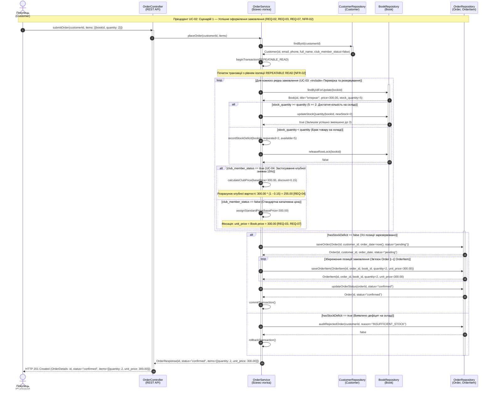
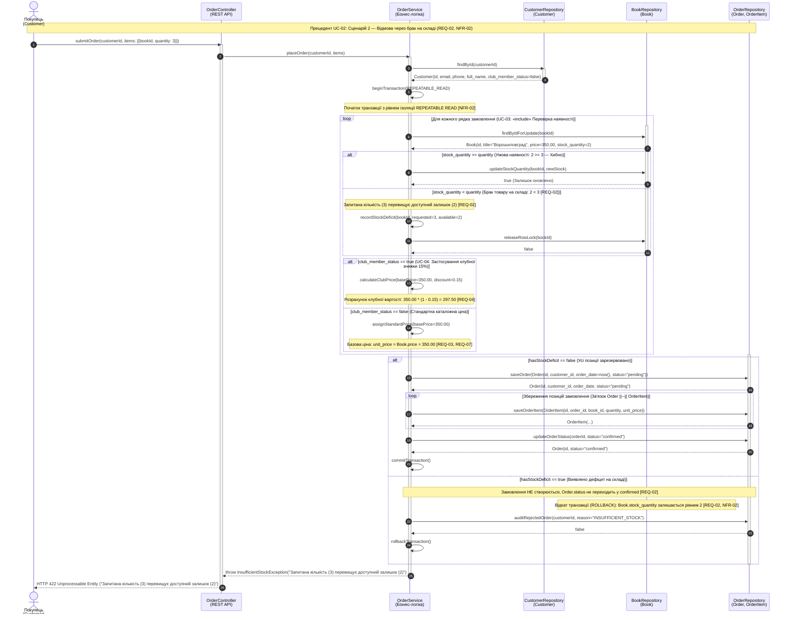
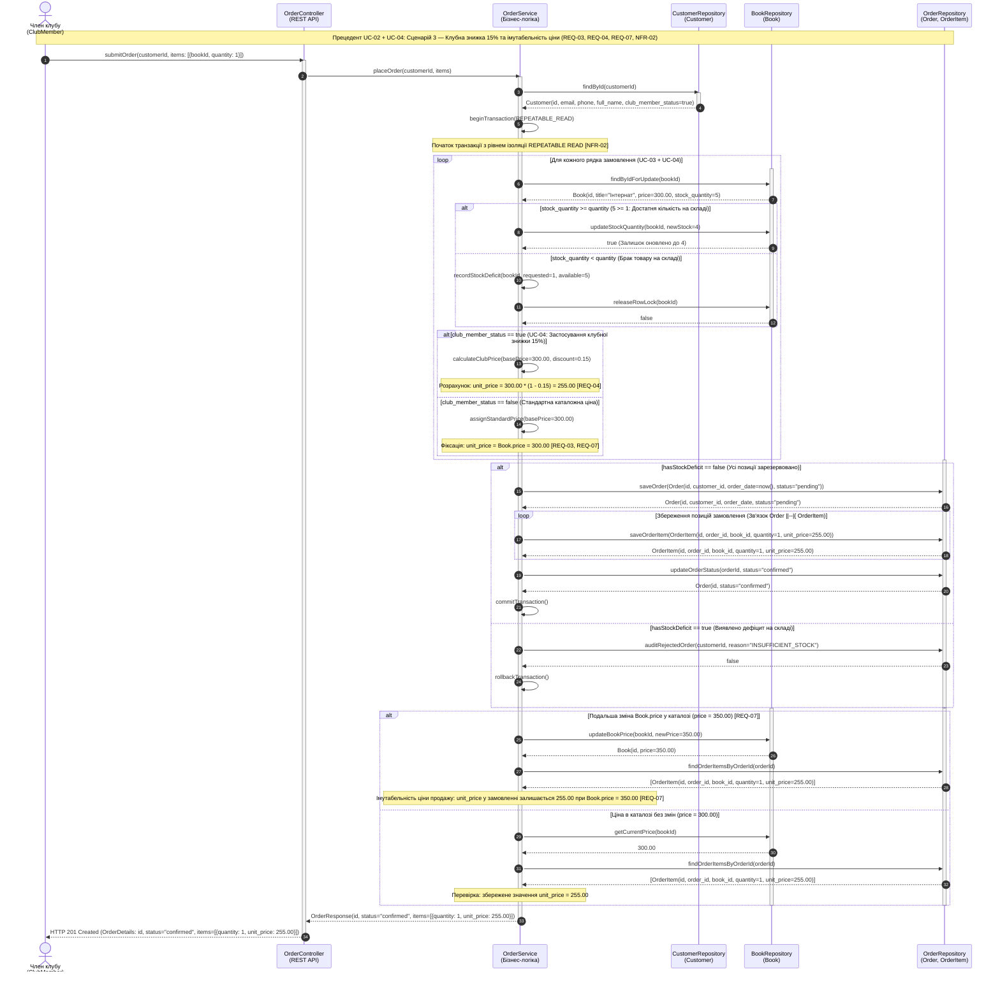

# Документація взаємодії компонентів (Sequence Diagrams): Прецедент `UC-02: Оформлення замовлення на книги`

**Проєкт:** Онлайн-книгарня «Клуб читачів»  
**Лабораторна робота:** №3  
**Документ:** `Labs/lab-3/interactions.md`  
**Вхідні артефакти:**
* Специфікація вимог до діаграм послідовності: [`Labs/lab-3/spec.md`](./spec.md)
* Концептуальна модель даних (ER): [`Labs/lab-1/model.mmd`](../lab-1/model.mmd)
* Специфікація вимог, User Stories та сценарії Gherkin: [`Labs/lab-2/requirements.md`](../lab-2/requirements.md)

---

## 1. Вступ та системний контекст

Даний документ деталізує динамічну взаємодію компонентів інформаційної системи онлайн-книгарні для виконання ключового бізнес-прецеденту **`UC-02: Оформлення замовлення на книги`**. Специфікація охоплює три повноцінні сценарії виконання, визначені у [Завданні 2](../lab-2/requirements.md) та нормалізовані відповідно до концептуальної моделі даних 3NF із [Завдання 1](../lab-1/model.mmd):

1. **Сценарій 1 (Позитивний потік — «Happy Path»):** Успішне оформлення замовлення звичайним покупцем (`club_member_status = false`) на 2 примірники книги «Інтернат» за достатньої кількості на складі книгарні (`Book.stock_quantity >= OrderItem.quantity`). Реалізує прецеденти `UC-02` та обов'язковий `UC-03: Перевірка наявності книг на складі` (`«include»`).
2. **Сценарій 2 (Негативний потік — «Alternative/Exception Path»):** Відмова в оформленні замовлення при спробі замовити 3 примірники книги «Ворошиловград», що перевищує фактичний складський залишок у 2 примірники (`OrderItem.quantity > Book.stock_quantity`). Захищає бізнес від перепродажу (overselling) та демонструє механізм відкату транзакції (`ROLLBACK`) згідно з `REQ-02` та `NFR-02` (`UC-02` + `UC-03`).
3. **Сценарій 3 (Потік розширення — «Extension Flow»):** Оформлення замовлення авторизованим членом клубу (`club_member_status = true`) на 1 примірник книги «Інтернат» із автоматичним застосуванням персональної знижки 15% (`OrderItem.unit_price = 255.00`), збереженням історичної ціни продажу при зміні каталожної вартості до 350.00 грн (`REQ-07`) та перевіркою імутабельності. Реалізує ланцюг `UC-02` + `UC-03` + розширення `UC-04: Застосування клубної ціни` (`«extend» [club_member_status = true]`).

---

## 2. Учасники взаємодії (Participants & Lifelines)

Усі лінії життя (Lifelines) у діаграмах послідовності суворо розмежовують рівні архітектури (REST Controller, Application Service, Data Repositories) та безпосередньо мапляться на сутності концептуальної ER-моделі Завдання 1:

| Учасник (Lifeline) | Стереотип / Тип | Відповідальність у системі | Відповідні сутності ER (Lab 1) | Задіяні атрибути моделі (3NF) |
| :--- | :--- | :--- | :--- | :--- |
| **`Customer`** / **`ClubMember`** | `actor` | Клієнт книгарні, який ініціює замовлення книг через вебінтерфейс. Має ознаку участі у читацькому клубі. | `Customer` | `id`, `full_name`, `club_member_status` |
| **`OrderController`** | `boundary` / `control` | Вхідний REST API контролер; приймає HTTP-запити, виконує первинну DTO-десеріалізацію та повертає HTTP-відповіді клієнту. | — (API Boundary) | — |
| **`OrderService`** | `service` | Оркестратор бізнес-логіки; керує явними БД-транзакціями з рівнем ізоляції `REPEATABLE_READ` (`NFR-02`), координує перевірку залишків, обчислює ціни та ініціює `commit` / `rollback`. | `Order`, `OrderItem` | Керує станами `Order.status`, обчислює `OrderItem.unit_price` |
| **`CustomerRepository`** | `repository` | Шар доступу до даних клієнтів; забезпечує пошук покупця за ідентифікатором та отримання його клубного статусу. | `Customer` | `id`, `email`, `phone`, `full_name`, `club_member_status`, `created_at` |
| **`BookRepository`** | `repository` | Шар доступу до каталогу книг та складу; виконує блокування рядків `FOR UPDATE`, списання залишків, звільнення блокувань `releaseRowLock`, читання та зміну цін. | `Book` | `id`, `isbn`, `title`, `publication_year`, `price`, `stock_quantity` |
| **`OrderRepository`** | `repository` | Шар персистентності замовлень; забезпечує збереження `Order`, позицій `OrderItem`, аудит відхилених спроб `auditRejectedOrder` та вибірку за ідентифікатором. | `Order`, `OrderItem` | `Order` (`id`, `customer_id`, `order_date`, `status`), `OrderItem` (`id`, `order_id`, `book_id`, `quantity`, `unit_price`) |

---

## 3. Детальний опис та специфікація сценаріїв

### 3.1. Сценарій 1: Успішне оформлення замовлення за достатньої кількості книг на складі

* **Тип потоку:** Позитивний основний потік (Happy Path).
* **Прецеденти:** `UC-02: Оформлення замовлення на книги`, `UC-03: Перевірка наявності книг на складі` (`«include»`).
* **Вимоги EARS:** `REQ-02`, `REQ-03`, `REQ-07`, `NFR-02`.
* **User Story:** `US-02`.
* **Сценарій Gherkin:** `Labs/lab-2/requirements.md` (Сценарій 2).

#### Передумови (Preconditions):
1. Покупець зареєстрований у системі з ідентифікатором `customerId` та параметром `club_member_status = false`.
2. У каталозі зареєстрована книга «Інтернат» (`id = bookId`, `price = 300.00`, `stock_quantity = 5`).
3. Покупець формує запит на придбання 2 примірників (`quantity = 2`).

#### Покроковий опис взаємодії:
1. `Customer` відправляє HTTP-запит `submitOrder(customerId, items: [{bookId, quantity: 2}])` до `OrderController`. Лінія життя `OrderController` активується через явну директиву `activate OrderController`.
2. `OrderController` викликає `OrderService.placeOrder(customerId, items)`. Лінія життя `OrderService` активується через `activate OrderService` і залишається нерозривно активною до завершення сценарію.
3. `OrderService` запитує дані покупця: `CustomerRepository.findById(customerId)`. Лінія `CustomerRepository` активується на час виклику.
4. `CustomerRepository` повертає сутність `Customer(..., club_member_status = false)`. `CustomerRepository` деактивується.
5. `OrderService` явно відкриває транзакцію бази даних: `OrderService->>OrderService: beginTransaction(REPEATABLE_READ)` відповідно до вимоги `NFR-02`.
6. **Фрагмент `loop` (Перевірка та резервування для кожного рядка замовлення):**
   * Перед викликом блокування активується `BookRepository` (`activate BookRepository`).
   * `OrderService` виконує запит `BookRepository.findByIdForUpdate(bookId)`, блокуючи рядок на рівні СКБД (`SELECT ... FOR UPDATE`).
   * `BookRepository` повертає `Book(id, title="Інтернат", price=300.00, stock_quantity=5)`.
   * **Двогілковий фрагмент `alt` (Перевірка наявності примірників):**
     * `[stock_quantity >= quantity (5 >= 2: Достатній залишок)]`: `OrderService` викликає `BookRepository.updateStockQuantity(bookId, newStock=3)`. Залишок успішно зменшується до 3 примірників. Репозиторій повертає `true`.
     * `[else stock_quantity < quantity (Брак товару)]`: Фіксується дефіцит через `recordStockDeficit()`, після чого викликається `BookRepository.releaseRowLock(bookId)` із поверненням `false` для коректного завершення блокування.
   * Після завершення фрагмента `alt` лінія `BookRepository` коректно деактивується (`deactivate BookRepository`). Оскільки репозиторій задіяний в обох гілках, смуга активності є абсолютно нерозривною через увесь блок.
   * **Двогілковий фрагмент `alt` (Розрахунок вартості позиції):**
     * `[club_member_status == true (UC-04: Клубна знижка 15%)]`: Виклик `calculateClubPrice()`.
     * `[else club_member_status == false (Стандартна каталожна ціна)]`: Оскільки клієнт не є членом клубу, `OrderService` викликає внутрішній метод `assignStandardPrice(basePrice=300.00)` та фіксує значення `unit_price = Book.price = 300.00` відповідно до `REQ-03` та `REQ-07`.
7. **Двогілковий фрагмент `alt` (Завершення обробки транзакції):**
   * Перед початком блоку активується `OrderRepository` (`activate OrderRepository`).
   * `[hasStockDeficit == false (Усі позиції зарезервовано)]`:
     * `OrderService` викликає `OrderRepository.saveOrder()` зі значенням `status = 'pending'`, генеруючи сурогатний `id` та фіксуючи `order_date = now()`.
     * **Фрагмент `loop` (Збереження позицій `OrderItem`):** Для кожного рядка створюється асоціативний запис `OrderRepository.saveOrderItem(OrderItem(id, order_id, book_id, quantity=2, unit_price=300.00))`.
     * `OrderService` переводить статус замовлення у стан `confirmed` через `OrderRepository.updateOrderStatus(orderId, status="confirmed")`.
     * `OrderService` явно фіксує транзакцію: `commitTransaction()`.
   * `[else hasStockDeficit == true (Виявлено дефіцит на складі)]`: Викликається `OrderRepository.auditRejectedOrder(customerId, reason="INSUFFICIENT_STOCK")` та `rollbackTransaction()`.
   * Після завершення блоку `alt` `OrderRepository` деактивується (`deactivate OrderRepository`), забезпечуючи суцільну лінію активності репозиторію.
8. `OrderService` повертає контролеру відповідь `OrderResponse(id, status="confirmed", items=[{quantity: 2, unit_price: 300.00}])` та деактивується (`deactivate OrderService`).
9. `OrderController` повертає покупцеві відповідь `HTTP 201 Created` з підтвердженими даними замовлення та деактивується (`deactivate OrderController`).

#### Діаграма послідовності (Mermaid):
Вихідний файл: [`Labs/lab-3/scenario-1-order-success.mmd`](./scenario-1-order-success.mmd)  
Графічний рендер: [`Labs/lab-3/scenario-1-order-success.png`](./scenario-1-order-success.png)

#### Постумови (Postconditions):
* Створено сутність `Order` зі статусом `status = 'confirmed'`.
* Створено 1 запис `OrderItem` із `quantity = 2` та зафіксованою ціною `unit_price = 300.00`.
* Складський залишок `Book.stock_quantity` книги «Інтернат» зменшено з 5 до 3 примірників.

---

### 3.2. Сценарій 2: Відмова в оформленні замовлення при перевищенні наявного залишку на складі

* **Тип потоку:** Негативний потік обробки виняткової ситуації (Exception / Stock Deficit Flow).
* **Прецеденти:** `UC-02: Оформлення замовлення на книги`, `UC-03: Перевірка наявності книг на складі` (`«include»`).
* **Вимоги EARS:** `REQ-02`, `NFR-02`.
* **User Story:** `US-02`.
* **Сценарій Gherkin:** `Labs/lab-2/requirements.md` (Сценарій 3).

#### Передумови (Preconditions):
1. Покупець формує замовлення на книгу «Ворошиловград» (`id = bookId`, `price = 350.00`).
2. Фактичний залишок книги на складі складає лише 2 примірники (`Book.stock_quantity = 2`).
3. Покупець запитує 3 примірники (`quantity = 3`).

#### Покроковий опис взаємодії:
1. `Customer` відправляє HTTP-запит `submitOrder(customerId, items: [{bookId, quantity: 3}])`. Лінія життя `OrderController` активується (`activate OrderController`).
2. `OrderController` передає керування методу `OrderService.placeOrder(customerId, items)`. Лінія життя `OrderService` активується (`activate OrderService`).
3. `OrderService` викликає `CustomerRepository.findById(customerId)` та отримує дані профілю клієнта (`club_member_status = false`).
4. `OrderService` відкриває транзакцію: `beginTransaction(REPEATABLE_READ)`.
5. **Фрагмент `loop` (Перевірка наявності примірників):**
   * Перед блокуванням активується `BookRepository` (`activate BookRepository`).
   * `OrderService` викликає `BookRepository.findByIdForUpdate(bookId)` і зчитує поточний стан книги `Book(title = "Ворошиловград", stock_quantity = 2)`.
   * **Двогілковий фрагмент `alt` (Оцінка умови `stock_quantity >= quantity`):**
     * `[stock_quantity >= quantity (2 >= 3: Хибно)]`: Гілка списання залишку не виконується.
     * `[else stock_quantity < quantity (Брак товару на складі: 2 < 3 [REQ-02])]`:
       * `OrderService` викликає внутрішній метод `recordStockDeficit(bookId, requested = 3, available = 2)`.
       * Встановлюється системний прапорець дефіциту `hasStockDeficit = true`.
       * `OrderService` викликає `BookRepository.releaseRowLock(bookId)` для звільнення блокування запису книги, і репозиторій повертає `false`.
   * Лінія `BookRepository` деактивується строго після `end` (`deactivate BookRepository`), формуючи суцільну лінію активності в обох гілках.
   * **Двогілковий фрагмент `alt` (Тарифікація позиції):**
     * `[club_member_status == true]`: Клубна знижка.
     * `[else club_member_status == false]`: `OrderService` викликає `assignStandardPrice(basePrice=350.00)`.
6. **Двогілковий фрагмент `alt` (Завершення обробки транзакції):**
   * Перед початком блоку активується `OrderRepository` (`activate OrderRepository`).
   * `[hasStockDeficit == false]`: Збереження замовлення не виконується.
   * `[else hasStockDeficit == true (Виявлено дефіцит на складі)]`:
     * Збереження записів `Order` та `OrderItem` повністю блокується; статус не переходить у `confirmed`.
     * `OrderService` реєструє подію відхилення в базі даних: `OrderRepository.auditRejectedOrder(customerId, reason="INSUFFICIENT_STOCK")`. Репозиторій повертає `false`.
     * `OrderService` викликає явний метод відкату транзакції: `OrderService->>OrderService: rollbackTransaction()` (`ROLLBACK`).
     * Завдяки транзакційному відкату значення `Book.stock_quantity` книги «Ворошиловград» гарантовано залишається рівним 2 примірникам (`REQ-02`, `NFR-02`).
   * Після завершення блоку лінія `OrderRepository` деактивується (`deactivate OrderRepository`).
7. Після завершення фрагмента транзакції `OrderService` повертає контролеру виключення `throw InsufficientStockException("Запитана кількість (3) перевищує доступний залишок (2)")` та деактивується (`deactivate OrderService`).
8. `OrderController` повертає покупцеві клієнтську помилку `HTTP 422 Unprocessable Entity` із детальним описом причини та деактивується (`deactivate OrderController`).

#### Діаграма послідовності (Mermaid):
Вихідний файл: [`Labs/lab-3/scenario-2-insufficient-stock.mmd`](./scenario-2-insufficient-stock.mmd)  
Графічний рендер: [`Labs/lab-3/scenario-2-insufficient-stock.png`](./scenario-2-insufficient-stock.png)

#### Постумови (Postconditions):
* Жодного запису в таблицях `Order` та `OrderItem` не створено.
* Зафіксовано запис аудиту відхиленого замовлення в `OrderRepository`.
* Статус замовлення не перейшов у `confirmed`.
* Складський залишок книги «Ворошиловград» не змінився і становить `Book.stock_quantity = 2`.
* Клієнт отримав точне повідомлення про причину відмови та доступний залишок.

---

### 3.3. Сценарій 3: Оформлення замовлення членом клубу із застосуванням клубної знижки 15%

* **Тип потоку:** Потік розширення бізнес-правил (Extension Flow).
* **Прецеденти:** `UC-02: Оформлення замовлення на книги`, `UC-03: Перевірка наявності книг на складі` (`«include»`), `UC-04: Застосування клубної ціни` (`«extend» [club_member_status = true]`).
* **Вимоги EARS:** `REQ-03`, `REQ-04`, `REQ-07`, `NFR-02`.
* **User Story:** `US-03`.
* **Сценарій Gherkin:** `Labs/lab-2/requirements.md` (Сценарій 4).

#### Передумови (Preconditions):
1. Авторизовано покупця-члена клубу `ClubMember` із параметром `club_member_status = true`.
2. Книга «Інтернат» має каталожну вартість `price = 300.00` та залишок `stock_quantity = 5`.
3. Член клубу підтверджує придбання 1 примірника (`quantity = 1`).

#### Покроковий опис взаємодії:
1. `ClubMember` надсилає запит на оформлення замовлення `submitOrder(customerId, items: [{bookId, quantity: 1}])`. Активується контролер (`activate OrderController`).
2. `OrderController` передає керування сервісу `OrderService.placeOrder(customerId, items)`. Активується сервіс (`activate OrderService`).
3. `OrderService` звертається до `CustomerRepository.findById(customerId)`.
4. `CustomerRepository` повертає сутність покупця з ознакою `club_member_status = true`.
5. `OrderService` ініціює транзакцію: `beginTransaction(REPEATABLE_READ)`.
6. **Фрагмент `loop` (Перевірка наявності та клубна тарифікація):**
   * Активується `BookRepository` (`activate BookRepository`).
   * `OrderService` викликає `BookRepository.findByIdForUpdate(bookId)` та отримує дані книги «Інтернат» (`price = 300.00`, `stock_quantity = 5`).
   * **Двогілковий фрагмент `alt` (Перевірка залишку `5 >= 1`):**
     * `[stock_quantity >= quantity (5 >= 1: Успішно)]`: Викликається `BookRepository.updateStockQuantity(bookId, newStock=4)`. Залишок зменшується до 4. Репозиторій повертає `true`.
     * `[else stock_quantity < quantity]`: Фіксація дефіциту та виклик `releaseRowLock(bookId)` із поверненням `false` (не викликається).
   * Лінія `BookRepository` деактивується строго після `end` (`deactivate BookRepository`).
   * **Двогілковий фрагмент `alt` (Застосування клубної ціни — Прецедент `UC-04`):**
     * `[club_member_status == true (UC-04: «extend» [club_member_status = true])]`:
       * `OrderService` викликає метод `calculateClubPrice(basePrice=300.00, discount=0.15)`.
       * Виконується розрахунок: $300.00 \times (1 - 0.15) = 255.00$ грн (`REQ-04`).
       * Розраховане значення фіксується як ціна продажу: `unit_price = 255.00`.
     * `[else club_member_status == false]`: Стандартна каталожна ціна (не викликається).
7. **Двогілковий фрагмент `alt` (Завершення обробки транзакції):**
   * Перед початком блоку активується `OrderRepository` (`activate OrderRepository`).
   * `[hasStockDeficit == false (Усі позиції зарезервовано)]`:
     * `OrderService` створює замовлення: `OrderRepository.saveOrder(Order(id, customer_id, order_date=now(), status="pending"))`.
     * **Фрагмент `loop` (Збереження позицій):** Викликається `OrderRepository.saveOrderItem(OrderItem(id, order_id, book_id, quantity=1, unit_price=255.00))`.
     * Замовлення підтверджується: `OrderRepository.updateOrderStatus(orderId, status="confirmed")`.
     * `OrderService` виконує фіксацію транзакції: `commitTransaction()`.
   * `[else hasStockDeficit == true]`: Викликається `auditRejectedOrder(...)` та `rollbackTransaction()`.
   * Лінія `OrderRepository` деактивується строго після `end` (`deactivate OrderRepository`).
8. **Двогілковий фрагмент `alt` (Моделювання імутабельності історичної ціни `REQ-07` за сценарієм Gherkin):**
   * Перед початком блоку явно активуються обидва репозиторії: `activate BookRepository` та `activate OrderRepository`.
   * `[Подальша зміна Book.price у каталозі (price = 350.00) [REQ-07]]`:
     * Адміністратор або каталог оновлює базову ціну книги: `BookRepository.updateBookPrice(bookId, newPrice=350.00)`.
     * Репозиторій повертає оновлену книгу `Book(id, price=350.00)`.
     * Система повторно зчитує позиції оформленого замовлення: `OrderRepository.findOrderItemsByOrderId(orderId)`.
     * `OrderRepository` повертає збережений список, де `unit_price` залишається рівним `255.00`.
     * Доведено інваріант `REQ-07`: ціна продажу `unit_price` у замовленні не залежить від майбутніх змін каталогу.
   * `[else Ціна в каталозі без змін (price = 300.00)]`:
     * Виконується контрольне читання поточної ціни: `BookRepository.getCurrentPrice(bookId)` із поверненням `300.00`.
     * Зчитування `OrderRepository.findOrderItemsByOrderId(orderId)` підтверджує незмінність зафіксованого `unit_price = 255.00`.
   * Строго після `end` деактивуються обидва репозиторії: `deactivate BookRepository` та `deactivate OrderRepository`, утворюючи нерозривні паралельні смуги активності через обидві гілки.
9. `OrderService` повертає контролеру `OrderResponse(id, status="confirmed", items=[{quantity: 1, unit_price: 255.00}])` та деактивується (`deactivate OrderService`).
10. `OrderController` повертає члену клубу `HTTP 201 Created` з підтвердженими даними та деактивується (`deactivate OrderController`).

#### Діаграма послідовності (Mermaid):
Вихідний файл: [`Labs/lab-3/scenario-3-club-member-discount.mmd`](./scenario-3-club-member-discount.mmd)  
Графічний рендер: [`Labs/lab-3/scenario-3-club-member-discount.png`](./scenario-3-club-member-discount.png)

#### Постумови (Postconditions):
* Створено сутність `Order` із `status = 'confirmed'`.
* Створено позицію `OrderItem` із клубною ціною `unit_price = 255.00` (знижка 15% від каталожної вартості 300.00 грн).
* Складський залишок книги `Book.stock_quantity` зменшено з 5 до 4.
* Ціна продажу `unit_price = 255.00` верифікована як імутабельна при подальшому зростанні ціни книги в каталозі до 350.00 грн (`REQ-07`).

---

## 4. Матриця наскрізної трасованості (Traceability Matrix)

Таблиця встановлює суворий двосторонній зв'язок між сценаріями приймального тестування Gherkin (Лабораторна робота №2), спроєктованими Sequence-діаграмами (Лабораторна робота №3) та сутностями й атрибутами концептуальної ER-моделі даних (Лабораторна робота №1).

| Сценарій Gherkin (Lab 2) | Діаграма послідовності (Lab 3) | Прецеденти Use Case | Вимоги EARS | Сутності ER (Lab 1) | Задіяні атрибути моделі даних (3NF, Lab 1) | Методи та операції Sequence Diagram |
| :--- | :--- | :--- | :--- | :--- | :--- | :--- |
| **Сценарій 2:** Успішне оформлення замовлення за достатньої кількості книг на складі | [`scenario-1-order-success.mmd`](./scenario-1-order-success.mmd) [`scenario-1-order-success.png`](./scenario-1-order-success.png) | `UC-02`, `UC-03` (`«include»`) | `REQ-02`, `REQ-03`, `REQ-07`, `NFR-02` | `Customer`, `Book`, `Order`, `OrderItem` | • `Customer.id`, `club_member_status` • `Book.id`, `title`, `price`, `stock_quantity` • `Order.id`, `customer_id`, `order_date`, `status` • `OrderItem.id`, `order_id`, `book_id`, `quantity`, `unit_price` | • `submitOrder()` • `placeOrder()` • `findById()` • `beginTransaction()` • `findByIdForUpdate()` • `updateStockQuantity()` • `releaseRowLock()` • `assignStandardPrice()` • `saveOrder()` • `saveOrderItem()` • `updateOrderStatus()` • `auditRejectedOrder()` • `commitTransaction()` |
| **Сценарій 3:** Відмова в оформленні замовлення при перевищенні наявного залишку на складі | [`scenario-2-insufficient-stock.mmd`](./scenario-2-insufficient-stock.mmd) [`scenario-2-insufficient-stock.png`](./scenario-2-insufficient-stock.png) | `UC-02`, `UC-03` (`«include»`) | `REQ-02`, `NFR-02` | `Customer`, `Book`, `Order`, `OrderItem` | • `Customer.id`, `club_member_status` • `Book.id`, `title`, `price`, `stock_quantity` • `OrderItem.quantity`, `book_id` • `Order.status` | • `submitOrder()` • `placeOrder()` • `findById()` • `beginTransaction()` • `findByIdForUpdate()` • `recordStockDeficit()` • `releaseRowLock()` • `assignStandardPrice()` • `auditRejectedOrder()` • `rollbackTransaction()` |
| **Сценарій 4:** Оформлення замовлення членом клубу із застосуванням клубної знижки | [`scenario-3-club-member-discount.mmd`](./scenario-3-club-member-discount.mmd) [`scenario-3-club-member-discount.png`](./scenario-3-club-member-discount.png) | `UC-02`, `UC-03` (`«include»`), `UC-04` (`«extend»`) | `REQ-03`, `REQ-04`, `REQ-07`, `NFR-02` | `Customer`, `Book`, `Order`, `OrderItem` | • `Customer.id`, `club_member_status` • `Book.id`, `title`, `price`, `stock_quantity` • `Order.id`, `customer_id`, `order_date`, `status` • `OrderItem.id`, `order_id`, `book_id`, `quantity`, `unit_price` | • `submitOrder()` • `placeOrder()` • `findById()` • `beginTransaction()` • `findByIdForUpdate()` • `updateStockQuantity()` • `releaseRowLock()` • `calculateClubPrice()` • `saveOrder()` • `saveOrderItem()` • `updateOrderStatus()` • `auditRejectedOrder()` • `commitTransaction()` • `updateBookPrice()` • `getCurrentPrice()` • `findOrderItemsByOrderId()` |

---

## 5. Обґрунтування застосування комбінованих фрагментів UML

Усі три Sequence-діаграми використовують виключно повноцінні комбіновані фрагменти стандарту UML 2.5:

1. **Фрагмент `loop` (Циклічна обробка позицій замовлення):**
   * Оскільки зв'язок між замовленням і позиціями має кардинальність $1..*$ (`Order ||--|{ OrderItem`), операції перевірки наявності книги на складі (`BookRepository.findByIdForUpdate`), тарифікації та генерації записів `OrderItem` відбуваються в циклі `loop` для кожного елемента вхідного масиву позицій замовлення.
2. **Двогілкові фрагменти `alt ... else ...` замість неповних блоків `opt`:**
   * **Повнота умовного покриття:** Використання двогілкових блоків `alt ... else ...` забезпечує детермінованість і виключає «мовчазні» невизначені стани системи. Кожна бізнес-умова обов'язково специфікує як позитивну гілку, так і альтернативну:
     * *Перевірка залишку:* `alt stock_quantity >= quantity` (резервування залишку через `updateStockQuantity`) `else stock_quantity < quantity` (фіксація дефіциту `recordStockDeficit` та явне звільнення блокування `releaseRowLock`).
     * *Розрахунок вартості позиції:* `alt club_member_status == true` (розрахунок клубної вартості `calculateClubPrice`) `else club_member_status == false` (призначення базової ціни `assignStandardPrice`).
     * *Фіналізація транзакції:* `alt hasStockDeficit == false` (збереження сутностей замовлення та `commitTransaction`) `else hasStockDeficit == true` (аудит відхилення `auditRejectedOrder` та `rollbackTransaction`).
     * *Перевірка імутабельності (Сценарій 3):* `alt Подальша зміна Book.price у каталозі (price = 350.00)` (оновлення прайсу `updateBookPrice` та підтвердження `unit_price = 255.00`) `else Ціна в каталозі без змін` (контрольне читання `getCurrentPrice` та підтвердження `unit_price = 255.00`).
3. **Нерозривність Activation Bars:**
   * Для контролера `OrderController` та сервісу `OrderService` смуги активності починаються до першого циклу або розгалуження та завершуються після фінального повернення відповіді клієнту, не обриваючись на внутрішніх гілках.
   * Для репозиторіїв `BookRepository` та `OrderRepository` директиви `activate` виносяться строго **ДО** початку блоків `alt`, а `deactivate` — строго **ПІСЛЯ** завершення `end`. Завдяки наявності операцій для обох репозиторіїв в обох гілках кожного `alt` (`updateStockQuantity` vs `releaseRowLock`, `saveOrder` vs `auditRejectedOrder`, `updateBookPrice` vs `getCurrentPrice`), лінії активності репозиторіїв є суцільними та нерозривними.

---

## 6. Транзакційна цілісність та чистота 3NF (`NFR-02`, `REQ-07`)

* **Явне керування транзакціями:** Початок атомарної транзакції моделюється прямим викликом `OrderService->>OrderService: beginTransaction(REPEATABLE_READ)`. Завершення транзакції відбувається виключно через виклики `commitTransaction()` (у разі успішного резервування всіх книг) або `rollbackTransaction()` (при виявленні нестачі хоча б однієї книги), що гарантує вимогу `NFR-02` (0 колізій race condition, відсутність від'ємних залишків).
* **Песимістичне блокування:** Виклик `BookRepository.findByIdForUpdate(bookId)` накладає блокування `SELECT ... FOR UPDATE` на час транзакції, захищаючи складські залишки від паралельного списання іншими потоками, а у разі браку товару блокування явно знімається викликом `releaseRowLock(bookId)`.
* **Суворе дотримання 3NF:** Усі повідомлення, аргументи викликів та об'єкти відповідей містять виключно атрибути концептуальної моделі даних Завдання 1 (`Customer`, `Book`, `Order`, `OrderItem`). Розрахункові денормалізовані поля (`total_amount`, `discount_amount`, `savings`) повністю вилучені з інтерфейсів сервісу.
