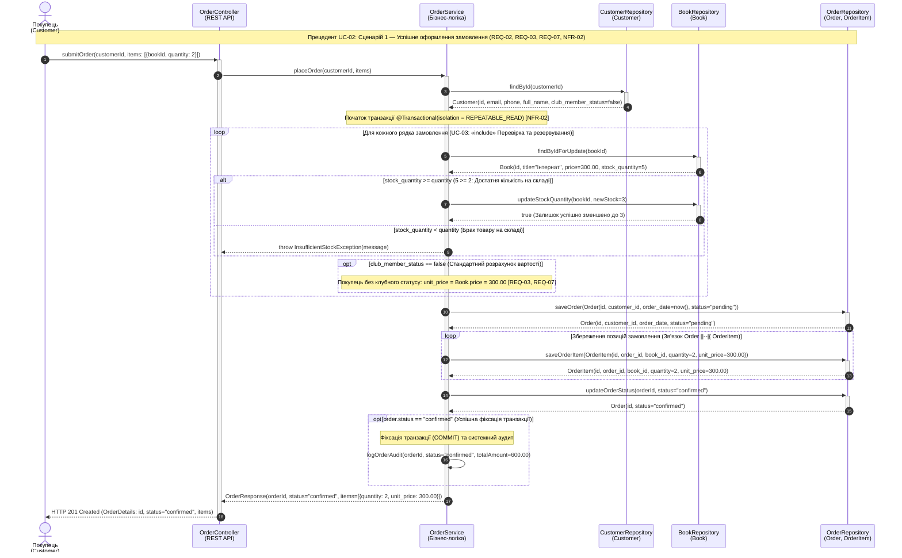
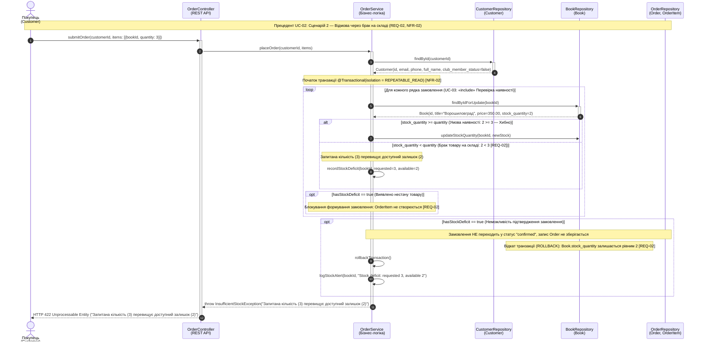
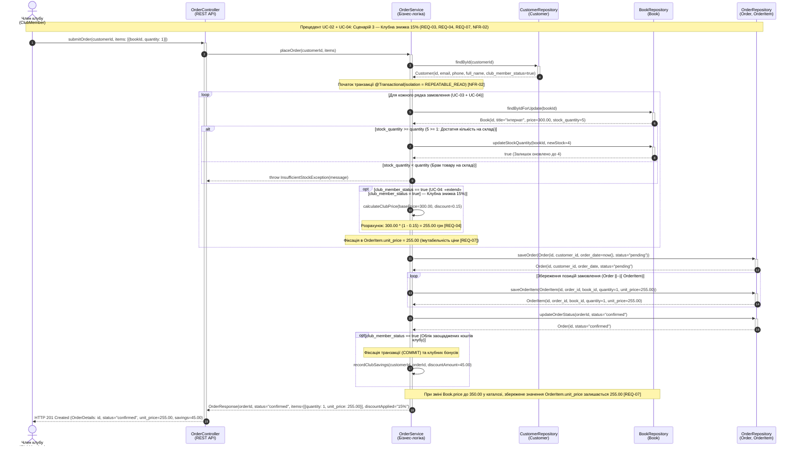

# Документація взаємодії компонентів (Sequence Diagrams): Прецедент `UC-02: Оформлення замовлення на книги`

**Проєкт:** Онлайн-книгарня «Клуб читачів»  
**Лабораторна робота:** №3  
**Документ:** `Labs/lab-3/interactions.md`  
**Вхідні артефакти:**
* Специфікація вимог до діаграм послідовності: [`Labs/lab-3/spec.md`](file:///d:/system-modeling-labs/Labs/lab-3/spec.md)
* Концептуальна модель даних (ER): [`Labs/lab-1/model.mmd`](file:///d:/system-modeling-labs/Labs/lab-1/model.mmd)
* Специфікація вимог, User Stories та сценарії Gherkin: [`Labs/lab-2/requirements.md`](file:///d:/system-modeling-labs/Labs/lab-2/requirements.md)

---

## 1. Вступ та системний контекст

Даний документ деталізує динамічну взаємодію компонентів інформаційної системи онлайн-книгарні для виконання ключового бізнес-прецеденту **`UC-02: Оформлення замовлення на книги`**. Специфікація охоплює три повноцінні сценарії виконання, визначені у [Завданні 2](file:///d:/system-modeling-labs/Labs/lab-2/requirements.md#L276-L315) та нормалізовані відповідно до концептуальної моделі даних 3NF із [Завдання 1](file:///d:/system-modeling-labs/Labs/lab-1/model.mmd):

1. **Сценарій 1 (Позитивний потік — «Happy Path»):** Успішне оформлення замовлення звичайним покупцем (`club_member_status = false`) за достатньої кількості обраних книг на складі книгарні (`Book.stock_quantity >= OrderItem.quantity`). Реалізує прецеденти `UC-02` та обов'язковий `UC-03: Перевірка наявності книг на складі` (`«include»`).
2. **Сценарій 2 (Негативний потік — «Alternative/Exception Path»):** Відмова в оформленні замовлення при спробі замовити кількість примірників, що перевищує фактичний складський залишок (`OrderItem.quantity > Book.stock_quantity`). Захищає бізнес від перепродажу (overselling) та демонструє механізм відкату транзакції (`UC-02` + `UC-03`).
3. **Сценарій 3 (Потік розширення — «Extension Flow»):** Оформлення замовлення авторизованим членом клубу (`club_member_status = true`) з автоматичним застосуванням персональної знижки 15% та фіксацією історичної ціни `OrderItem.unit_price`. Реалізує ланцюг `UC-02` + `UC-03` + розширення `UC-04: Застосування клубної ціни` (`«extend» [club_member_status = true]`).

---

## 2. Учасники взаємодії (Participants & Lifelines)

Усі лінії життя (Lifelines) у діаграмах послідовності суворо розмежовують рівні архітектури (REST Controller, Application Service, Data Repositories) та безпосередньо мапляться на сутності концептуальної ER-моделі Завдання 1.

| Учасник (Lifeline) | Стереотип / Тип | Відповідальність у системі | Відповідні сутності ER (Lab 1) | Задіяні атрибути моделі |
| :--- | :--- | :--- | :--- | :--- |
| **`Customer`** / **`ClubMember`** | `actor` | Клієнт книгарні, який ініціює замовлення книг через вебінтерфейс. Має ознаку участі у читацькому клубі. | `Customer` | `id`, `full_name`, `club_member_status` |
| **`OrderController`** | `boundary` / `control` | Вхідний REST API контролер; приймає HTTP-запити, виконує первинну DTO-десеріалізацію та повертає HTTP-відповіді. | — (API Boundary) | — |
| **`OrderService`** | `service` | Оркестратор бізнес-логіки; відкриває БД-транзакції з ізоляцією `REPEATABLE_READ` (`NFR-02`), координує валідацію залишків, обчислює ціни та знижки. | `Order`, `OrderItem` | Керує станами `Order.status`, обчислює `OrderItem.unit_price` |
| **`CustomerRepository`** | `repository` | Шар доступу до даних клієнтів; забезпечує пошук покупця за ідентифікатором та отримання його клубного статусу. | `Customer` | `id`, `email`, `phone`, `full_name`, `club_member_status`, `created_at` |
| **`BookRepository`** | `repository` | Шар доступу до каталогу книг та складу; виконує песимістичне або транзакційне блокування рядків (`FOR UPDATE`) та списання залишків. | `Book` | `id`, `isbn`, `title`, `publication_year`, `price`, `stock_quantity` |
| **`OrderRepository`** | `repository` | Шар персистентності замовлень; забезпечує атомарне збереження заголовка `Order` та позицій `OrderItem`. | `Order`, `OrderItem` | `Order` (`id`, `customer_id`, `order_date`, `status`), `OrderItem` (`id`, `order_id`, `book_id`, `quantity`, `unit_price`) |

---

## 3. Детальний опис та специфікація сценаріїв

### 3.1. Сценарій 1: Успішне оформлення замовлення за достатньої кількості книг на складі

* **Тип потоку:** Позитивний основний потік (Happy Path).
* **Прецеденти:** `UC-02: Оформлення замовлення на книги`, `UC-03: Перевірка наявності книг на складі` (`«include»`).
* **Вимоги EARS:** `REQ-02`, `REQ-03`, `REQ-07`, `NFR-02`.
* **User Story:** `US-02`.
* **Сценарій Gherkin:** `Labs/lab-2/requirements.md` (Сценарій 2 — рядки 280–289).

#### Передумови (Preconditions):
1. Покупець зареєстрований у системі з ідентифікатором `customerId` та параметром `club_member_status = false`.
2. У каталозі зареєстрована книга «Інтернат» (`id = bookId`, `price = 300.00`, `stock_quantity = 5`).
3. Покупець формує запит на придбання 2 примірників (`quantity = 2`).

#### Покроковий опис взаємодії:
1. `Customer` відправляє HTTP POST-запит до `OrderController.submitOrder(customerId, items: [{bookId, quantity: 2}])`.
2. `OrderController` активується та делегує обробку `OrderService.placeOrder(customerId, items)`.
3. `OrderService` звертається до `CustomerRepository.findById(customerId)` для верифікації клієнта та його клубного статусу.
4. `CustomerRepository` повертає сутність `Customer(..., club_member_status = false)`.
5. `OrderService` відкриває атомарну транзакцію бази даних із рівнем ізоляції `REPEATABLE READ` згідно з вимогою `NFR-02`.
6. **Фрагмент `loop` (Перевірка наявності для кожної книги):** Для кожного елемента замовлення викликається `BookRepository.findByIdForUpdate(bookId)` з блокуванням рядка для усунення race condition.
7. **Фрагмент `alt` (Умова залишку `stock_quantity >= quantity`):**
   * *Гілка 5 >= 2 (Істина):* `OrderService` викликає `BookRepository.updateStockQuantity(bookId, newStock = 3)`. Складський залишок зменшується на 2 і стає рівним 3 примірникам. Репозиторій повертає `true`.
   * *Гілка (Хибно):* Викидається виключення `InsufficientStockException` (у цьому сценарії не викликається).
8. **Фрагмент `opt` (`club_member_status == false`):** Оскільки покупець є звичайним клієнтом, знижка не нараховується. Значення `OrderItem.unit_price` фіксується рівним базовій каталожній вартості `Book.price` (300.00 грн) відповідно до `REQ-03` та `REQ-07`.
9. `OrderService` викликає `OrderRepository.saveOrder()` зі значенням `status = 'pending'`, генеруючи сурогатний `id` та фіксуючи `order_date = now()`.
10. **Фрагмент `loop` (Збереження позицій `OrderItem`):** Для кожної книги створюється асоціативний запис `OrderItem(id, order_id, book_id, quantity = 2, unit_price = 300.00)`.
11. `OrderService` переводить замовлення у фінальний підтверджений стан `OrderRepository.updateOrderStatus(orderId, status = 'confirmed')`.
12. **Фрагмент `opt` (`order.status == 'confirmed'`):** `OrderService` виконує системний аудит операції `logOrderAudit()` та підтверджує фіксацію транзакції (`COMMIT`).
13. `OrderService` повертає DTO `OrderResponse` контролеру.
14. `OrderController` повертає клієнту відповідь `HTTP 201 Created` з підтвердженими даними замовлення.

#### Діаграма послідовності (Mermaid):
Вихідний файл: [`Labs/lab-3/scenario-1-order-success.mmd`](file:///d:/system-modeling-labs/Labs/lab-3/scenario-1-order-success.mmd)  
Графічний рендер: [`Labs/lab-3/scenario-1-order-success.png`](file:///d:/system-modeling-labs/Labs/lab-3/scenario-1-order-success.png)

#### Постумови (Postconditions):
* Створено запис `Order` зі статусом `status = 'confirmed'`.
* Створено 1 запис `OrderItem` із `quantity = 2` та зафіксованою ціною `unit_price = 300.00`.
* Складський залишок `Book.stock_quantity` книги «Інтернат» зменшено з 5 до 3.

---

### 3.2. Сценарій 2: Відмова в оформленні замовлення при перевищенні наявного залишку на складі

* **Тип потоку:** Негативний потік обробки виняткової ситуації (Exception / Stock Deficit Flow).
* **Прецеденти:** `UC-02: Оформлення замовлення на книги`, `UC-03: Перевірка наявності книг на складі` (`«include»`).
* **Вимоги EARS:** `REQ-02`, `NFR-02`.
* **User Story:** `US-02`.
* **Сценарій Gherkin:** `Labs/lab-2/requirements.md` (Сценарій 3 — рядки 293–302).

#### Передумови (Preconditions):
1. Покупець формує замовлення на книгу «Ворошиловград» (`id = bookId`, `price = 350.00`).
2. Фактичний залишок книги на складі складає лише 2 примірники (`Book.stock_quantity = 2`).
3. Покупець запитує 3 примірники (`quantity = 3`).

#### Покроковий опис взаємодії:
1. `Customer` надсилає запит на оформлення `submitOrder(customerId, items: [{bookId, quantity: 3}])`.
2. `OrderController` делегує виконання методу `OrderService.placeOrder()`.
3. `OrderService` звертається до `CustomerRepository.findById()` та отримує дані профілю клієнта.
4. `OrderService` ініціює транзакцію з ізоляцією `REPEATABLE READ`.
5. **Фрагмент `loop` (Перевірка наявності примірників):** `OrderService` викликає `BookRepository.findByIdForUpdate(bookId)` і зчитує поточний стан книги `Book(title = "Ворошиловград", stock_quantity = 2)`.
6. **Фрагмент `alt` (Оцінка умови `stock_quantity >= quantity`):**
   * *Гілка 2 >= 3 (Хибно):* Спрацьовує альтернативна гілка нестачі товару `stock_quantity < quantity` (`REQ-02`).
   * `OrderService` викликає внутрішній метод `recordStockDeficit(bookId, requested = 3, available = 2)` та виставляє прапорець помилки `hasStockDeficit = true`.
7. **Фрагмент `opt` (`hasStockDeficit == true` всередині циклу):** Блокується створення будь-яких позицій `OrderItem` для дефіцитної книги.
8. **Фрагмент `opt` (`hasStockDeficit == true` на рівні сервісу):**
   * Замовлення не зберігається в `OrderRepository`, статус не переходить у стан `confirmed`.
   * `OrderService` ініціює примусовий відкат транзакції `rollbackTransaction()` (`ROLLBACK`).
   * Завдяки відкату транзакції значення `Book.stock_quantity` книги «Ворошиловград» гарантовано залишається рівним 2.
   * Фіксується запис у лог помилок `logStockAlert()`.
9. `OrderService` генерує та викидає виняток `InsufficientStockException("Запитана кількість (3) перевищує доступний залишок (2)")`.
10. `OrderController` перехоплює бізнес-виняток та формує клієнту відповідь `HTTP 422 Unprocessable Entity` із детальним описом помилки та доступною кількістю товару.

#### Діаграма послідовності (Mermaid):
Вихідний файл: [`Labs/lab-3/scenario-2-insufficient-stock.mmd`](file:///d:/system-modeling-labs/Labs/lab-3/scenario-2-insufficient-stock.mmd)  
Графічний рендер: [`Labs/lab-3/scenario-2-insufficient-stock.png`](file:///d:/system-modeling-labs/Labs/lab-3/scenario-2-insufficient-stock.png)

#### Постумови (Postconditions):
* Жодного запису в таблицях `Order` та `OrderItem` не створено.
* Статус замовлення не перейшов у `confirmed`.
* Складський залишок книги «Ворошиловград» не змінився і становить `Book.stock_quantity = 2`.
* Клієнт отримав точне повідомлення про причину відмови та доступний ліміт.

---

### 3.3. Сценарій 3: Оформлення замовлення членом клубу із застосуванням клубної знижки 15%

* **Тип потоку:** Потік розширення бізнес-правил (Extension Flow).
* **Прецеденти:** `UC-02: Оформлення замовлення на книги`, `UC-03: Перевірка наявності книг на складі` (`«include»`), `UC-04: Застосування клубної ціни` (`«extend» [club_member_status = true]`).
* **Вимоги EARS:** `REQ-03`, `REQ-04`, `REQ-07`, `NFR-02`.
* **User Story:** `US-03`.
* **Сценарій Gherkin:** `Labs/lab-2/requirements.md` (Сценарій 4 — рядки 306–315).

#### Передумови (Preconditions):
1. Авторизовано покупця-члена клубу `ClubMember` із параметром `club_member_status = true`.
2. Книга «Інтернат» має каталожну вартість `price = 300.00` та залишок `stock_quantity = 5`.
3. Член клубу підтверджує придбання 1 примірника (`quantity = 1`).

#### Покроковий опис взаємодії:
1. `ClubMember` надсилає запит на оформлення замовлення `submitOrder(customerId, items: [{bookId, quantity: 1}])`.
2. `OrderController` активує бізнес-метод `OrderService.placeOrder()`.
3. `OrderService` викликає `CustomerRepository.findById(customerId)`.
4. `CustomerRepository` повертає сутність покупця з ознакою `club_member_status = true`.
5. `OrderService` відкриває транзакцію `REPEATABLE READ`.
6. **Фрагмент `loop` (Перевірка наявності та клубна калькуляція):** `OrderService` викликає `BookRepository.findByIdForUpdate(bookId)` та отримує дані книги «Інтернат» (ціна 300.00, залишок 5).
7. **Фрагмент `alt` (`stock_quantity >= quantity`):** Оскільки 5 >= 1, `OrderService` оновлює складський залишок через `BookRepository.updateStockQuantity(bookId, newStock = 4)`. Залишок успішно зменшується до 4.
8. **Фрагмент `opt` (`club_member_status == true` — Прецедент `UC-04`):**
   * Спрацьовує правило розширення `«extend» [club_member_status = true]` (`REQ-04`).
   * `OrderService` викликає внутрішній метод `calculateClubPrice(basePrice = 300.00, discount = 0.15)`.
   * Виконується розрахунок: $300.00 \times (1 - 0.15) = 255.00$ грн.
   * Обчислена знижена вартість зберігається як значення позиції: `unit_price = 255.00`.
   * **Незмінність історичної ціни (`REQ-07`):** Зафіксоване значення `unit_price = 255.00` є імутабельним. Подальші коливання ціни книги в каталозі (наприклад, подорожчання книги до 350.00 грн) жодним чином не вплинуть на збережене замовлення.
9. `OrderService` створює запис `Order` зі статусом `pending` через `OrderRepository.saveOrder()`.
10. **Фрагмент `loop` (Збереження рядків замовлення):** `OrderService` зберігає позицію замовлення `OrderItem(id, order_id, book_id, quantity = 1, unit_price = 255.00)`.
11. `OrderService` фіналізує замовлення у базі даних: `updateOrderStatus(orderId, status = 'confirmed')`.
12. **Фрагмент `opt` (`club_member_status == true` після створення замовлення):** Сервіс фіксує отриману клієнтом вигоду: `recordClubSavings(customerId, orderId, discountAmount = 45.00 грн)` та виконує `COMMIT` транзакції.
13. `OrderService` повертає контролеру `OrderResponse` із параметрами підтвердженого замовлення та позначкою застосованої 15% знижки.
14. `OrderController` повертає члену клубу `HTTP 201 Created` з фіксацією ціни продажу 255.00 грн та розміром економії 45.00 грн.

#### Діаграма послідовності (Mermaid):
Вихідний файл: [`Labs/lab-3/scenario-3-club-member-discount.mmd`](file:///d:/system-modeling-labs/Labs/lab-3/scenario-3-club-member-discount.mmd)  
Графічний рендер: [`Labs/lab-3/scenario-3-club-member-discount.png`](file:///d:/system-modeling-labs/Labs/lab-3/scenario-3-club-member-discount.png)

#### Постумови (Postconditions):
* Створено сутність `Order` із `status = 'confirmed'`.
* Створено позицію `OrderItem` із клубною ціною `unit_price = 255.00` (знижка 15% від каталожної вартості 300.00 грн).
* Складський залишок книги `Book.stock_quantity` зменшено з 5 до 4.
* Ціна продажу залишається захищеною від будь-яких наступних коригувань прайсу книги в каталозі (`REQ-07`).

---

## 4. Матриця наскрізної трасованості (Traceability Matrix)

Таблиця встановлює суворий двосторонній зв'язок між сценаріями приймального тестування Gherkin (Лабораторна робота №2), спроєктованими Sequence-діаграмами (Лабораторна робота №3) та сутностями й атрибутами концептуальної ER-моделі даних (Лабораторна робота №1).

| Сценарій Gherkin (Lab 2) | Діаграма послідовності (Lab 3) | Прецеденти Use Case | Вимоги EARS | Сутності ER (Lab 1) | Задіяні атрибути моделі даних (Lab 1) | Методи та операції Sequence Diagram |
| :--- | :--- | :--- | :--- | :--- | :--- | :--- |
| **Сценарій 2:** Успішне оформлення замовлення за достатньої кількості книг на складі | [`scenario-1-order-success.mmd`](file:///d:/system-modeling-labs/Labs/lab-3/scenario-1-order-success.mmd) [`scenario-1-order-success.png`](file:///d:/system-modeling-labs/Labs/lab-3/scenario-1-order-success.png) | `UC-02`, `UC-03` (`«include»`) | `REQ-02`, `REQ-03`, `REQ-07`, `NFR-02` | `Customer`, `Book`, `Order`, `OrderItem` | • `Customer.id`, `club_member_status` • `Book.id`, `title`, `price`, `stock_quantity` • `Order.id`, `customer_id`, `order_date`, `status` • `OrderItem.id`, `order_id`, `book_id`, `quantity`, `unit_price` | • `submitOrder()` • `placeOrder()` • `findById()` • `findByIdForUpdate()` • `updateStockQuantity()` • `saveOrder()` • `saveOrderItem()` • `updateOrderStatus()` • `logOrderAudit()` |
| **Сценарій 3:** Відмова в оформленні замовлення при перевищенні наявного залишку на складі | [`scenario-2-insufficient-stock.mmd`](file:///d:/system-modeling-labs/Labs/lab-3/scenario-2-insufficient-stock.mmd) [`scenario-2-insufficient-stock.png`](file:///d:/system-modeling-labs/Labs/lab-3/scenario-2-insufficient-stock.png) | `UC-02`, `UC-03` (`«include»`) | `REQ-02`, `NFR-02` | `Customer`, `Book`, `Order`, `OrderItem` | • `Customer.id`, `club_member_status` • `Book.id`, `title`, `price`, `stock_quantity` • `OrderItem.quantity`, `book_id` • `Order.status` | • `submitOrder()` • `placeOrder()` • `findById()` • `findByIdForUpdate()` • `recordStockDeficit()` • `rollbackTransaction()` • `logStockAlert()` |
| **Сценарій 4:** Оформлення замовлення членом клубу із застосуванням клубної знижки | [`scenario-3-club-member-discount.mmd`](file:///d:/system-modeling-labs/Labs/lab-3/scenario-3-club-member-discount.mmd) [`scenario-3-club-member-discount.png`](file:///d:/system-modeling-labs/Labs/lab-3/scenario-3-club-member-discount.png) | `UC-02`, `UC-03` (`«include»`), `UC-04` (`«extend»`) | `REQ-03`, `REQ-04`, `REQ-07`, `NFR-02` | `Customer`, `Book`, `Order`, `OrderItem` | • `Customer.id`, `club_member_status` • `Book.id`, `title`, `price`, `stock_quantity` • `Order.id`, `customer_id`, `order_date`, `status` • `OrderItem.id`, `order_id`, `book_id`, `quantity`, `unit_price` | • `submitOrder()` • `placeOrder()` • `findById()` • `findByIdForUpdate()` • `updateStockQuantity()` • `calculateClubPrice()` • `saveOrder()` • `saveOrderItem()` • `updateOrderStatus()` • `recordClubSavings()` |

---

## 5. Обґрунтування застосування комбінованих фрагментів UML

Усі три Sequence-діаграми використовують комбіновані фрагменти стандарту UML 2.5 для вираження складної алгоритмічної логіки:

1. **Фрагмент `loop` (Циклічна обробка позицій замовлення):**
   * Оскільки зв'язок між замовленням і позиціями має кардинальність $1..*$ (`Order ||--|{ OrderItem`), операції валідації наявності книги на складі (`BookRepository.findByIdForUpdate`), оновлення залишку та генерації записів `OrderItem` відбуваються в циклі `loop` для кожного елемента вхідного масиву замовлення.
2. **Фрагмент `alt` (Альтернативні потоки валідації залишку):**
   * Реалізує обов'язкову перевірку `UC-03: Перевірка наявності книг на складі`. Умова `stock_quantity >= quantity` розділяє позитивний потік резервування товару від виключного стану браку товару. У Сценарії 1 та 3 виконується успішна гілка зі списанням залишку, а в Сценарії 2 спрацьовує гілка браку товару з відмовою у створенні позиції замовлення (`REQ-02`).
3. **Фрагмент `opt` (Опціональна поведінка та бізнес-правила):**
   * **У Сценарії 1:** `opt club_member_status == false` демонструє умовну поведінку фіксації базової каталожної вартості у полі `OrderItem.unit_price`, а `opt order.status == "confirmed"` — опціональний аудит успішної операції.
   * **У Сценарії 2:** `opt hasStockDeficit == true` регламентує критичні дії блокування додавання рядків замовлення, скасування транзакції (`ROLLBACK`) та збереження початкового незмінного стану `Book.stock_quantity`.
   * **У Сценарії 3:** `opt club_member_status == true` точно візуалізує точку розширення Use Case прецеденту `UC-04: Застосування клубної ціни` (`«extend» [club_member_status = true]`), де виконується перерахунок вартості зі знижкою 15% та фіксація отриманої економії.

---

## 6. Транзакційна цілісність та конкурентність (`NFR-02`)

* **Рівень ізоляції транзакції:** Усі операції зміни складських залишків та формування замовлення оркеструються сервісом `OrderService` в межах єдиної транзакції бази даних із рівнем ізоляції `REPEATABLE READ`.
* **Песимістичне блокування рядків:** Запит `BookRepository.findByIdForUpdate(bookId)` накладає блокування `SELECT ... FOR UPDATE` на запис книги. Це унеможливлює ситуацію паралельного перепродажу (race condition) одних і тих самих примірників книги декількома покупцями одночасно, гарантуючи виконання вимоги `NFR-02` (0 колізій, залишок ніколи не набуває від'ємного значення `stock_quantity < 0`).
* **Атомарність (ACID):** У разі виявлення нестачі товару (Сценарій 2) транзакція негайно відкочується без створення часткових або «розірваних» замовлень.
